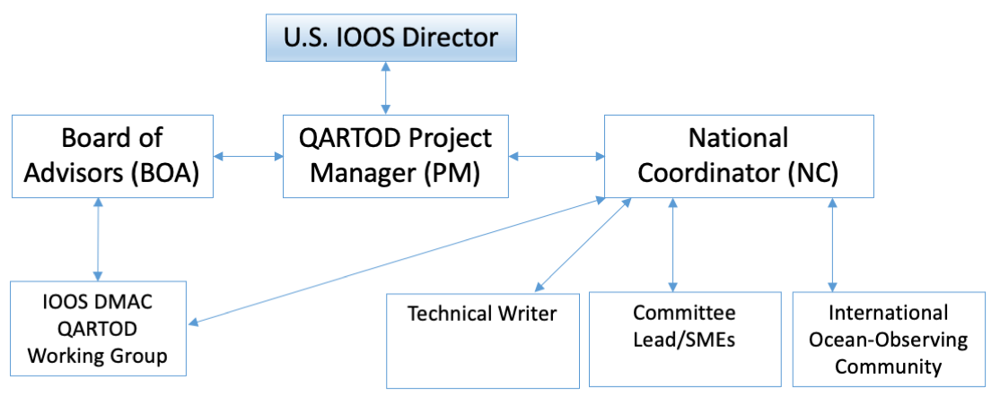

# QARTOD Project Plan Update 2022–2026

## Foreword 

The acronym QARTOD originally stood for Quality Assurance of Real-Time Oceanographic Data. 
However, 
the QARTOD Board of Advisors acknowledged that quality assurance and quality control were related but fundamentally different, 
which resulted in the development of official definitions for quality assurance (QA) and quality control (QC). 
The BOA also added quality control to the existing QARTOD logo, 
hence Quality Assurance/Quality Control of Real-Time Oceanographic Data. 
The two terms had been used interchangeably by many scientists, 
but these definitions became essential to distinguishing between the automated flags described in the tests outlined in each QARTOD manual (QC) and other processes that are also important to generating high quality data (QA). 

QA involves processes that are employed with hardware to support the generation of high-quality data, 
such as a sufficiently accurate, 
precise, 
and reliable sensor with adequate resolution. 
QA practices include sensor calibration; 
calibration checks and/or in-situ verification, 
including post-deployment calibration; 
proper deployment considerations, 
such as measures for corrosion control and antifouling; 
reliable data communications; 
and adequate maintenance intervals. 

QC involves follow-on steps that support the delivery of high-quality data and requires both automation and human intervention. 
QC practices include inspecting things such as format, 
checksum, 
timely arrival of data, 
threshold checks (minimum/maximum rate of change), 
nearest neighbor checks, 
climatology checks, 
model comparisons, 
signal/noise ratios, 
verification of user satisfaction, 
and generation of data flags (Bushnell 2005). 
Therefore, 
QARTOD manuals mainly focus on QC, 
although QA was included in most manuals until a separate QA paper (Bushnell et al. 2019) was published in Frontiers in Marine Science.¹

Using the QARTOD process, 
community members defined QC, QA, 
and several other terms (e.g., operator, codable instructions, real-time) to ensure that QARTOD manual users had a common understanding of terminology employed in each manual. 
Other terms vary by manual and are defined in a table of selected terms that appears in each manual. 

The first QARTOD project plan (Toll 2012) provided guidance for how the QARTOD process would work. 
A subsequent update created the existing manual format, 
adopted a flagging standard for QARTOD manuals (U.S. IOOS 2020b), 
and documented efforts to implement QC tests. 

This third iteration of the project plan is different from the other plans/updates in that it shifts the focus from an IOOS-led effort to a community-driven development of QARTOD manuals. 
This update is designed to help communities whose variables of interest (any variable relevant to IOOS but particularly biogeochemical variables) are not yet ready for a traditional QARTOD QC manual but are likely to benefit from the development of a QA/QC standardized process in the near future. 
This update helps provide a framework for those communities moving forward. 

<small>¹ https://www.frontiersin.org/articles/10.3389/fmars.2019.00706/full</small>

## Acknowledgements 

We owe Kathy Woody and Ed Kearns at the National Data Buoy Center (NDBC) credit for convening the first QARTOD workshop in 2003, 
before the QARTOD acronym had even been conceived. 
Bill Burnett and Dick Crout, 
both also at NDBC during the formative years of QARTOD deserve credit for sustaining the effort, 
as do Julie Thomas (University of California San Diego, retired), 
Julie Bosch (National Centers for Environmental Information), 
and Janet Fredericks (Woods Hole Oceanographic Institution, retired). 

We thank and acknowledge Zdenka Willis (U.S. IOOS, retired and now at Veraison Consulting) and Derrick Snowden (U.S. IOOS), 
CAPT Ray Toll (U.S. Navy, retired), 
and Joe Swaykos (NDBC, retired) for creating the QARTOD Project within U.S. IOOS, 
and thank the members of the QARTOD Board of Advisors (BOA, appendix A) for their continued support and guidance during the past ten years. 

We acknowledge with much gratitude Julie Thomas, 
whose leadership as BOA Chair was instrumental in establishing an effective role for QARTOD, 
and Eugene Burger, 
who became BOA Chair in 2022. 

The initial draft of this plan received reviews and support from a working group specifically formed for the task. 
Members included Emmanuel Boss (University of Maine), 
Jorge Brenner (Texas A&M University/Gulf of Mexico Coastal Ocean Observing System), 
Guilherme Castelão (University of California San Diego), 
Megan Kot (University of Victoria/Ocean Networks Canada), 
Ross Timmerman (University of California San Diego), 
and Christoph Waldmann (University of Bremen). 
The resulting draft was then reviewed by the present members of the QARTOD BOA. 

Additional reviews were provided by Joeseph Smith (Great Lakes Observing System) and Roxanne Carini (Northwest Association of Networked Ocean Observing Systems), 
as well as other representatives of U.S. IOOS Regional Associations. 

Finally, 
we wish to express our gratitude and appreciation to the hundreds of subject-matter experts who have graciously served on the development committees and reviewed and re-reviewed the draft QC manuals and supporting documents. 
Members of these subject communities have provided both the substance for the manuals and their support for implementation of the quality control tests. 
We are grateful for the opportunity to assist in creating these manuals and documents.

## Part 1 - Introduction and Purpose

### Introduction

The importance of oceanographic, 
meteorological, 
and biogeochemical data, 
both nationally and globally, 
has increased significantly during the last 20 years. 
Critical decisions in the public and private sectors are made based on these data; 
therefore, 
data providers (operators) and data users alike rely on high quality data for decision support. 

Data collection has become increasingly automated with the advent of sophisticated sensor and communications technology. 
The sheer volume of real-time environmental data requires systems that effectively transfer data from a sensor to a data assembly center where the data quality can be monitored using both automated flags and humans-in-the-loop. 
The realization of the need for fast, 
automated data quality control was one catalyst for the 2003 grassroots effort to define the minimum criteria (standardized processes) required to quality control real-time data. 
The 2003 meeting involved representatives from federal and state agencies, 
as well as academia and the private sector; 
they selected the official name of the effort: Quality Assurance of Real-Time Oceanographic Data² or QARTOD. 

   **Why is a Human-in-the-Loop necessary in an automated process?** 

      While we can expect more automation in the future, there will always be challenging cases that are too difficult to automate and require human intervention in order to appropriately assign quality control flags to data. Such cases enlighten operators and inform the next generation of automated QC. 

One of the first tasks undertaken by the representatives in 2003 was to describe the criteria needed for data quality control. 
This description became known as the Seven Laws of QARTOD. 

1. Every real-time observation distributed to the ocean community must be accompanied by a quality descriptor. 

2. All observations should be subject to some level of automated real-time quality test. 

3. Quality flags and quality test descriptions must be sufficiently described in the accompanying metadata.³

4. Observers should independently verify or calibrate a sensor before deployment. 

5. Observers should describe their method/calibration accuracy in the real-time metadata. 

6. Observers should quantify the level of calibration accuracy and the associated expected error bounds. 

7. Manual checks on the automated procedures, the real-time data collected and the status of the observing system must be provided by the observer on a time scale appropriate to ensure the integrity of the observing system. 

<small>² Later, the QARTOD Board of Advisors (BOA) recognized that quality assurance and quality control were different but both essential parts of data quality; therefore, quality control was added to the official name and the QARTOD logo was updated. The distinction between the two terms is described in every QARTOD manual, in the Foreword section of this document, and in appendix B.</small>

<small>³ For additional information, see https://ioos.github.io/ioos-metadata/index.html.</small> 

QARTOD remained a grassroots effort from 2003 to 2012, with six meetings hosted by various agencies. In 2012 the U.S. Integrated Ocean Observing System® (IOOS®) program agreed to adopt QARTOD as an official IOOS project. During this time, IOOS identified 26 core variables⁴ for which QARTOD manuals could be prepared and then developed a project plan outlining how QARTOD manuals would be written, reviewed, and published. IOOS used the sixth QARTOD meeting as the springboard for preparation of the first QARTOD manual (dissolved oxygen). 

The original project plan outlined the QARTOD management structure. 
Key personnel included the IOOS director, 
IOOS project manager, 
technical coordinator,⁵ 
technical writer, 
and the volunteer Board of Advisors (BOA). 
The BOA is a diverse group from a range of agencies and organizations providing general QARTOD project guidance to IOOS staff and relevant ocean observing communities (appendix A). 
Part of QARTOD’s function was to assist the U.S. IOOS Regional Associations (RAs) by providing standardization guidelines for the quality assurance and quality control of real-time data, which is one criterion for Regional Coastal Observing System (RCOS) certification. 

Since 2012, 
sixteen QARTOD manuals/papers and three project plans (including this update, see Table 1, listed chronologically by first issuance) have been developed. 
The manuals and project plans have Digital Object Identifiers (DOIs) associated with them for easy online access. 
The original QARTOD Project Plan set forth goals for 2012–2016 and was updated to cover 2017–2021. 
A summary of QARTOD accomplishments for 2017–2021 can be found in appendix C. 

   **QARTOD Accomplishments**

      Since 2012, sixteen QARTOD manuals/papers have been developed covering 17 of the 34 core variables representing physics, biogeochemistry, and biology/ecosystems. It is important to note that many of the biological and ecosystem variables do not have associated QARTOD manuals because real-time automated data dissemination is not yet possible for those variables. <u>Part 3</u> of this plan update provides more insight into the remaining core variables. 

### QARTOD Precepts 

As QARTOD has evolved, 
the following principles have guided the approach that IOOS, 
the BOA, and national coordinator (NC) have taken in establishing the role of QARTOD. 

- It is preferable to adopt existing standardized processes for QARTOD manuals rather than develop them. An example of this is the adoption of the Intergovernmental Oceanographic Commission (IOC) data flagging standard in 2014 (UNESCO 2013). 

- There are risks in being too prescriptive; therefore, the QARTOD manuals provide tests that can be implemented by operators (data providers) based on resources and how data are used. By design, required tests are easily implemented by all operators, while recommended and suggested tests meet the needs of operators with advanced capabilities. 

<small>⁴ This was later expanded to 34 core variables (https://www.iooc.us/task-teams/core-ioos-variables/).</small>

<small>⁵ The technical coordinator’s title was changed to national coordinator in 2018.</small>

- QARTOD manuals provide examples of test thresholds, but thresholds actually used by operators must be determined by the operators themselves, who are best suited to make those decisions. 

- While QARTOD is supported by IOOS, primarily for the eleven U.S. Regional Associations, the scope includes the international community as well. In addition to working toward internationally accepted standardized processes, efforts are leveraged globally. 

- QARTOD manuals can be used as teaching tools in the classroom. 

| U.S. IOOS QARTOD Manuals/Papers | Status | Core Variable Addressed |
|---|---|---|
| Dissolved Oxygen | 2nd Update Aug_2018 | Dissolved Oxygen |
| In-Situ Currents | 2nd Update July_2019 | Surface Currents |
| In-Situ Waves | 2nd Update Feb_2019 | Surface Waves |
| Temperature and Salinity | 2nd Update Feb_2020 | Temperature, Salinity |
| Water Level | 2nd Update Mar_2021 | Sea Level |
| Data Flags Manual | 2nd Update June_2020 | N/A |
| Wind Speed and Direction | Updated May_2017 | Wind Speed and Direction |
| Ocean Optics | Updated Aug_2017 | CDOM, Ocean Color, Optical Properties |
| Dissolved Nutrients | Updated Feb_2018 | Dissolved Nutrients |
| HFR Surface Currents | Completed May_2016 | Surface Currents |
| Glider DAC | Completed May_2016 | N/A |
| Phytoplankton Species and Abundance | Completed May_2017 | Phytoplankton Species |
| Passive Acoustics | Completed June_2017 | Sound |
| pH | Completed Aug_2019 | Acidity |
| Stream Flow | Completed Sep_2018 | Stream Flow |
| Quality Assurance | Completed Nov_2019 | N/A |
| **QARTOD Project Plans** | **Status** | **Core Variable Addressed** |
| QARTOD Project Plan | Completed Feb_2012 | N/A |
| QARTOD Project Plan Update | Completed Feb_2017 | N/A |
| QARTOD Project Plan Update | Completed May_2022 | N/A |

: Table 1. Summary of QARTOD Manual Status

As FY 2021 ended, 
the agencies and individuals responsible for QARTOD continued to plan for its sustainment for the next five years and beyond. 
The process for this project plan update began with a questionnaire (appendix D) given to the BOA to gather input for QARTOD’s future direction. 
A rough first draft of the updated project plan, 
prepared with guidance from this input, 
was provided to a newly formed working group of volunteers, 
who produced a draft reviewed by many others representing the ocean-observing community at large. 
The hallmark of each QARTOD process (appendix E) for creating and updating manuals and project plans is the wide circulation of each document to solicit input from as many reviewers as possible.

### Purpose 

This document is the second update of the QARTOD Project Plan for FY 2022–2026.⁶ 
This project plan is intended to inform the broad oceanographic community about continuing QARTOD activities that began in previous years (see _Part 2_) and identify new project efforts, 
as well as methods to address them (see _Part 3_).

<small>⁶ The original and updated project plans can be found at <http://dx.doi.org/10.25607/OBP-533> and <https://repository.library.noaa.gov/view/noaa/15621>, respectively.</small>

## Part 2 - Ongoing Core Activities from the 2017–2021 Plan

Six core activities (described below) have been central to the QARTOD project (appendix F) to ensure the quality of real-time data, 
and these activities will continue into the 2022–2026 period. 
They include the following:

- Foster implementation of existing manuals 

- Update manuals 

- Work with communities to develop new manuals as appropriate 

- Interact with international entities as appropriate 

- Promote outreach 

- Work with manufacturers to embed QC tests in instruments 

The first three activities mentioned are related to developing, 
reviewing, 
and publishing QARTOD manuals. 
The fourth one broadens the geographic scope of QARTOD to one of international interest through representation of the international community on the BOA, 
as well as providing the opportunity for representatives from the international community to review new and updated manuals. 
The fifth activity involves outreach through conferences, 
personal communications, 
annual U.S. IOOS Data Management and Cyberinfrastructure (DMAC) meetings, etc. to stay aware of trends, 
technologies, 
and other activities related to real-time data quality control. 
Finally, 
the sixth core activity involves interaction with manufacturers who seek to embed QC within their sensors’ software within fielddeployed instruments. 

The following sections describe plans to keep QARTOD’s momentum through its ongoing activities for the next five years. 

### Foster Implementation of Existing Manuals

The existence of a QARTOD manual, 
no matter how well done, 
does not ensure higher quality data unless the tests described in the manual are implemented. 
Implementation is crucial to improving data quality and identifying ways to refine real-time QC tests. 

In the previous project plan and update (Toll 2012; U.S. IOOS 2017), 
the national coordinator (NC), 
assisted by the IOOS project manager and the BOA, 
served as vital links to communicate the desire to learn who was implementing QARTOD’s QC tests and lessons learned from those efforts. 

The IOOS DMAC meeting (held annually in May/June) provides an opportunity to gather information about the efforts of regional data managers and the IOOS RAs to implement QARTOD QC tests. 
Outreach to the ocean-observing community at large through conferences, 
the LinkedIn QARTOD group (263 members), 
and emails have also helped to raise awareness of tracking implementation of QARTOD QC tests. 
These efforts will continue and hopefully expand as awareness of QARTOD manuals increases. 
As QARTOD standard processes are implemented, 
feedback from community members will be used to improve the manuals when they are updated. 
As the use of QARTOD manuals expands, 
we expect the amount of feedback received to increase; 
the effort to record, review, respond, 
and incorporate knowledge gained from that feedback will increase as well.

Through DMAC, 
leveraging opportunities are created to help share software and exchange methods. 
An example of this effort is described in U.S. IOOS (2020a); 
during a DMAC hackathon QARTOD Library Implementation session, 
multiple and distributed QARTOD GitHub libraries were consolidated into a single IOOS organization Python repository. 

Tracking QARTOD implementation, 
especially globally, 
is challenging. 
At the beginning of each manual is a request to manual users that states, 
“Please notify us of your efforts or intentions to implement QARTOD processes by sending a brief email to qartod.board@noaa.gov or posting a notice at <http://www.linkedin.com/groups?gid=2521409>.” 
But in practice, 
those implementing QARTOD QC tests rarely inform the NC, 
so compiling a list of entities using QARTOD standardized processes is difficult. 
Ideally, 
to help identify data that have been subjected to QARTOD tests, 
data repositories would reference the QARTOD manual DOI in their metadata that correspond to the QA/QC tests applied, 
or perhaps include ‘QARTOD Compliant’ in the accompanying metadata. 

### Update Manuals 

The process of preparing and updating manuals has been one of the hallmarks of QARTOD’s success. 
Each manual is distributed to a large list of national and international subject-matter experts from private and public sectors, 
as well as academia, 
for multiple reviews. 
Each reviewer comment is recorded in an adjudication matrix, 
along with whether the suggested revision or addition is accepted, 
and if not, why. 

Of the sixteen manuals completed since 2012, 
six have received two updates, 
four have received one update, and six have never been updated. 
Most manual updates have occurred every 2–4 years. 
Manuals can receive either an incremental or substantial update. 
Incremental updates are made to repair broken links, 
correct any minor editorial mistakes (e.g., typographical errors), 
or to incorporate other revisions that do not affect the QC tests used by operators. 
Substantial updates occur when advancing technology or other factors lead to changes in QC tests. 
Substantial updates will occur when a clear request for one is received from the affected community. 
To date, 
all manual updates have been incremental. 

One clear result of the questionnaire distributed to BOA members to prepare for this project plan update was the high value of updating existing QC manuals. 
The BOA members ranked this as the most important activity; 
however, 
the frequency and drivers of updates were less clear. 
In the past, 
most manuals have been updated approximately every three years. 
Some members felt that other factors beyond just elapsed time should be considered when deciding when to conduct an update. Consequently, 
the BOA will continue to participate in determining which manuals should be updated. 

While manual updates are a responsibility shared between the ocean observing community and the QARTOD NC, 
it is ultimately the responsibility of the NC to coordinate all updates. 
In 2022–2026 as with past QARTOD manuals, a team of subject-matter experts (SMEs) will draft manual updates, 
and then the updated manuals will be sent for community reviews, 
similar to the process used for initial creation. 
Once the period for reviews is complete, 
the suggested edits will be reviewed and accepted/rejected by the team of subject-matter experts; 
the updated manual then will be finalized. 

The final important task related to developing and updating manuals is ensuring that all manuals can be found easily. 
The practice of assigning a Digital Object Identifier (DOI) has become standard with all QARTOD manuals and other documents. 
Each one is available through the NOAA Institutional Repository,⁷ 
the IOOS website,⁸ 
and the Ocean Best Practices System Repository.⁹ 

### Work with Communities to Develop New Manuals as Appropriate 

The requirement for high-quality real-time data reaches beyond U.S. IOOS and Regional Associations. 
Ocean observing communities everywhere need to ensure data accuracy and precision, 
so future manuals might best be prepared by the communities deriving the most benefit from them. 
The existing manuals cover oceanographic and meteorological variables, 
as these variables can be monitored and reported in real-time. 
Only a few existing manuals cover biological variables, 
as many of the biological variables are not measured or tracked in real-time. 
In September 2020, 
the QARTOD BOA published a paper (U.S. IOOS 2020b) that charts the path forward for communities observing variables that do not yet have a manual. 
Also, 
Hörstmann et al. (2020) provide a useful source for those initiating the creation of a QARTOD manual. 

The U.S. IOOS leadership and the QARTOD BOA stand ready to assist communities wishing to develop new QARTOD manuals for variables that currently have no manual. 
Communities such as the Alliance for Coastal Technologies (ACT), 
the Global Ocean Ship-based Hydrographic Investigations Program (GOSHIP), 
and Ocean Observatories Initiative (OOI) might want to develop a QARTOD manual for a variable of interest to them. 
The QARTOD BOA recognizes that technological advancements might be needed before real-time QC can be implemented for many biological variables. 
However, 
the recent advancements in uncrewed platforms¹⁰ (beyond gliders and floats) make these data streams ripe for QA/QC standardization. 

### Interact with International Entities as Appropriate

Part of the NC’s role is to engage with the international community. 
The initial interaction occurred through soliciting reviewers for QARTOD manuals. 
This interaction has expanded to include international representation on the QARTOD BOA, 
as well as the NC’s participation in the Ocean Best Practices System (OBPS) Steering Group¹¹ and the U.S. Climate Variability and Predictability (CLIVAR) Ocean Uncertainty Working Group.¹² 
Inspiration and guidance can also be gained from interaction with the international meteorological community (e.g., the Global Climate Observing System’s Monitoring Principles)¹³ and the biological community (e.g., the biodiversity data quality interest group).¹⁴ 
These examples represent potential interactions through which expertise can be shared to further promote high-quality data. 

<small>⁷ https://repository.library.noaa.gov/</small> 

<small>⁸ https://ioos.noaa.gov/project/qartod/</small> 

<small>⁹ https://www.oceanbestpractices.org/</small> 

<small>¹⁰ https://sciencecouncil.noaa.gov/LinkClick.aspx?fileticket=4jWNkpk-ZBo=&portalid=0</small> 

<small>¹¹ https://www.oceanbestpractices.org/about/governance/</small> 

<small>¹² https://usclivar.org/working-groups/ocean-uncertainty-quantification-working-group-resources</small> 

<small>¹³ https://gcos.wmo.int/en/essential-climate-variables/about/gcos-monitoring-principles</small> 

<small>¹⁴ https://www.tdwg.org/community/bdq</small> 

Interaction with OBPS includes submitting QARTOD documents to the OBPS repository, 
which enhances global document accessibility. 
Strong QARTOD - OBPS engagement is highly synergistic, 
providing both entities with shared opportunities and resources.

### Promote Outreach 

QARTOD manuals provide information to the ocean observing community; 
however, 
outreach by the NC and BOA is vital for making sure the manuals are used. 
By presenting papers at conferences and participating in working groups and discussions, 
the NC and the BOA have been a conduit for the exchange of ideas about how to improve the quality of real-time data and implement the QARTOD tests. 
Community outreach has led to the identification of variables that were ready for a manual, 
specific tests to be included in manuals, 
and other important considerations, 
such as identifying the best data flagging scheme to adopt. 
Outreach has been a cornerstone for keeping QARTOD relevant and helpful to data providers (operators) as well as data users. 
A brief synopsis of the QARTOD Project serves as an outreach tool for the NC and BOA (appendix F). 

During 2017–2021, 
the role of outreach was extended to include the international community such as the OBPS Steering Group, 
and to include topics of interest such as measurement uncertainty. 

As previously mentioned, 
several universities use QARTOD QC manuals in the classroom. 
Introducing students in ocean science fields to manuals and methods early on is an important and rewarding future outreach effort to pursue. 

### Work with Manufacturers to Embed QC Tests in Instruments 

Many manufacturers have embedded QC tests within the sensor software, 
and they are encouraged to expand this capability (Bushnell 2017). 
However, 
it must be done cautiously and in concert with the desires of the community to ensure that controls and results produced do not introduce unexpected consequences. 
In general, 
the ability to embed QC tests into a field deployed system increases with the maturity of the system. 
For example, 
acoustic Doppler current profilers are mature instruments with QC protocols embedded in the sensor and the sensor processing software. 
Newer technologies are more likely to require a hands-on QC approach.

The benefits of embedded QC include less reliance on a single data management process, 
potentially faster data distribution, 
and enhanced interoperability. 
One example of enhanced interoperability is sensor neighbor interaction. 
Two sensors can themselves agree their extraordinary observations are valid. 
The embedded QC must be configurable by the operator so that local thresholds can be set and tests enabled/disabled.

One drawback of a field-deployed QC-enabled system is decentralized processing. 
Many think such edge computing is advantageous; others believe one shore-based system is easier to maintain.

   **What is Edge Computing?** 

      Edge computing is a distributed computing framework that brings enterprise applications closer to data sources such as Internet of Things or IoT devices or local edge servers (https://www.ibm.com/cloud/what-is-edge-computing). Edge computing operates on "instant data" that is real-time data generated by sensors or users (Hamilton, Eric [27 December 2018]. "What is Edge Computing: The Network Edge Explained." cloudwards.net. Retrieved 2022-01-25.). 

## Part 3 - New Activities for 2022–2026 

The six core activities described in Part 2 continue to be fundamental to QARTOD’s success. 
However, 
it is important to also consider the 34 variables selected by IOOS that represent physics, 
biogeochemistry, 
and biology/ecosystems.¹⁵ 
Many of the biological and ecosystem variables do not have associated QARTOD manuals because real-time automated data dissemination is not yet possible for those variables. 
The technology for data collection is still emerging for many of these variables, 
but QARTOD will engage with communities that work with biological variables to monitor ecological health and to meet their needs for QC (e.g., “timely data”) and best practice documentation. 
In addition to working with observatory operators and data users, 
QARTOD activities will also include engaging with manufacturers to determine if/when they believe development of a traditional QARTOD manual becomes appropriate or if embedded tests are practical. 

### BOA Questionnaire Results 

The BOA questionnaire discussed in Part 1 revealed multiple suggestions to move the QARTOD project forward. They include: 

- The five-year plan update should note that opportunities for expansion of QARTOD should be sought and developed as resources permit. 

- There was general agreement that the updated plan should state that the QARTOD effort includes working with operators to identify popular or emerging standardized processes, and then documenting and issuing them as QARTOD standardized processes. 

- QARTOD could expand documentation of sources of thresholds and resources supporting establishment of thresholds, without developing an extensive threshold database. 

- Artificial Intelligence (AI) and machine learning (ML) applications for QC processes are emerging fields, and the NC and BOA should follow their advances and plan for implementation once AI and ML processes are mature. 

- The BOA agreed to identify biologists for the working group formed for the five-year plan, and that several specific activities should be included in the plan (possible examples of these opportunities are described below). 

- The BOA consensus was that enforcing the use of QARTOD QC tests is not a QARTOD project function. 

- Early Career Ocean Professional (ECOP) participation in the development and writing of new manuals, papers, and updates is encouraged. ECOPs are more likely to have recent field experience and be familiar with the characteristics and limitations of the latest instrumentation. 

<small>¹⁵ https://www.iooc.us/task-teams/core-ioos-variables/</small>

### Potential New Efforts

Technological advances for existing sensors/variables and emerging technology for biological variables create opportunities for QARTOD, including: 

- Begin AI and ML QC efforts. Ad hoc ML communities at major oceanographic institutions have been created and may be an avenue for outreach. 

- Engage with manufacturers and operators to build real-time QC into sensors. 

- Explore the possibility of a more prescriptive stance in setting standardized processes. 

- Encourage the implementation and adherence to QARTOD QC tests more proactively. 

Many of these opportunities described in the bullets on the previous page veer away from the relatively narrow QARTOD focus on real-time QC manuals designed for an audience writing software to implement the tests. 
To accommodate these disparate opportunities, 
a different approach is required. 
The solution involves using the present QARTOD manual development process to address the development of any QA/QC-related standardized process. 
The project management section (Part 4) provides more information on how the QARTOD NC and BOA will manage these opportunities. 

The over-arching goal of QARTOD’s scope expansion is to provide a clear path to a broader community for the development and adoption of accepted standardized processes (e.g., uncertainty quantification and satellite/acoustic telemetry data for animal movements). 
Additional justifications include a) past suggestions for non-traditional QARTOD assistance (e.g., sargassum abundance, mangrove cover and composition), 
b) results from the questionnaire distributed to BOA members, c) a recognized need in the scientific community, 
and d) where no current best practices exist QARTOD can readily build upon a solid foundation. 

Using the QARTOD process, 
a community with an interest in a specific variable could create any QA/QC best practice for submission to IOOS through the QARTOD project. 
Initial agreement by IOOS would confirm that the proposed document is within scope. 
IOOS QARTOD guidance during the development of the document would be available, 
but the schedule is left to the variable community. 
Upon completion, 
the draft manual would be submitted to the QARTOD NC who would verify that the proper processes were followed and that the document matched the standardized appearance of a QARTOD manual. 
The manual would then be submitted for signature by the QARTOD BOA Chair, 
the QARTOD Project Manager, 
and the IOOS Director. 

For 2022–2026, 
the role of the QARTOD NC will shift from initiator/creator of real-time QC manuals to oversight of increasingly specific and complex QA/QC standardized processes developed by the appropriate SMEs. 
In fact, 
this returns QARTOD to the project originally envisioned by IOOS, 
where manual creation was proposed to be chaired by variable community leaders rather than the IOOS. 
Expanded use of the IOOS QARTOD project provides a clear path forward to a much broader community, 
just as it did for the initial grassroots wave and currents QARTOD efforts in 2012. 

Possible examples of efforts that might be covered under an expanded QARTOD scope include: 

- **Uncertainty quantification.** The 6ᵗʰ Law of QARTOD, “_Observers should quantify the level of calibration accuracy and the associated expected error bounds_” (Burnett et al. 2010), identifies but oversimplifies the need for detailed uncertainty quantification of ocean observations. Documents detailing specific variable/sensor/system uncertainties are sorely needed but challenging to create. Interaction with other stakeholder groups (e.g., U.S. CLIVAR OceanUQ or like-minded groups from the World Meteorological Organization) should be undertaken. 

- **Satellite and acoustic telemetry data for animal movement.** This is a location timeseries of biologging sensors used in habitat and connectivity studies of individual organisms. While many of the variables logged by the sensors are already addressed by QARTOD QC manuals (temperature, salinity, dissolved oxygen, etc.), there may be other quality-related aspects of animal tracking and variable observations. Content from the existing QARTOD passive acoustics QC manual may be leveraged for this application. 

- **Seascape climatologies.** This is a satellite-derived product now available through ERDDAP (Environmental Research Division’s Data Access Program) that classifies productivity of marine waters based in ocean color properties (14 classes). 

- **High frequency radar surface current observations antenna pattern measurements.** This includes both how to conduct the antenna pattern measurements and how to use the results. 

- **Vessel AIS data QC –** Automated Identification Systems (AIS) aboard vessels provide ship locations that can be used for a wide variety of applications. A standardized QC process would be welcomed by many communities.

## Part 4 - Project Management, Roles and Responsibilities

QARTOD includes representatives from a diverse group—one with an interest in providing and/or using real-time automated data. 
This wide reach has enabled QARTOD to communicate its mission and solicit input from hundreds of ocean observers around the globe representing both public and private entities.

The position descriptions of those responsible for managing QARTOD largely will remain the same for the 2022–2026 plan. 
The IOOS director and project manager, 
as well as the QARTOD NC and technical writer, 
will execute the 2022–2026 project plan. 
Those positions and description of duties are included in Figure 1 and discussed later in this section. 
The QARTOD BOA will continue to provide guidance and direction for QARTOD, 
and ocean observers from around the world will still serve as community reviewers for QARTOD manuals.

<figcaption>Figure 1. QARTOD Organizational Chart.</figcaption>

### Position Descriptions

The following eight positions (or groups) will be key implementors of QARTOD for future new and updated manuals. 
All have important roles in the process of improving data quality through QARTOD. 

#### IOOS Director

The Director approves all QARTOD manuals, 
promotes QARTOD within periodical announcements, 
and provides direction for all aspects of the QARTOD Project. 

#### Project Manager

The PM serves as the U.S. IOOS Program Office representative on the QARTOD BOA and answers directly to the Director. 
The PM also administers the funds for QARTOD and ensures implementation of the project plan and other related activities. 

#### Board of Advisors

The original project plan’s vision of a volunteer group of technical experts representing the U.S. IOOS community has supported the QARTOD Project in numerous ways and has been a valuable sounding board for the NC. 
The BOA has played an important role in identifying SMEs, 
reviewing manuals, 
and suggesting opportunities for outreach at conferences and other venues to share the QARTOD vision. 

The BOA has a volunteer chair who serves as a signatory for QARTOD manuals, 
but the NC moderates the quarterly BOA teleconferences. 
The current BOA membership of twelve (appendix A) is diverse in terms of expertise, 
gender, 
ethnicity, 
nationality, 
and age, 
and includes representatives from a broad variety of agencies. 
Though there has been no written guidance for any specific organizational aspects of the BOA, 
staggered four-year term limits for members so as to retain institutional knowledge was one outcome of the BOA questionnaire. 
It was agreed that four-year term limits with an option of renewing for another four would be implemented. 

#### National Coordinator 

The QARTOD Project NC receives guidance from U.S. IOOS management, 
the QARTOD PM, 
and the QARTOD BOA. 
The NC works closely with the technical writer and shall: 

- Assist in the development and maintenance of manuals describing oceanographic data QA/QC best practices for real-time/timely delivery. Suggest variables to be addressed, solicit support from co-editors and other manual content providers and reviewers, and participate in drafting manuals. 

- Conduct quarterly QARTOD BOA meetings by scheduling, providing agendas, hosting, and drafting meeting minutes. Provide interim updates to the BOA as necessary. 

- Monitor implementation of the QA/QC practices by participating in meetings convened by entities developing operational capabilities. For example, attend meetings of the IOOS National Glider Data Assembly Center (DAC), the IOOS National High Frequency Radar Program, and the U.S. IOOS DMAC workshops. 

- Conduct project outreach through presentations at conferences and workshops, both in person and supporting others to leverage opportunities. Host workshops or sessions focused on realtime/timely QA/QC. 

- Work with U.S. IOOS staff, PM, the BOA and the technical writer to develop annual plans, arrange for web postings, and issuance of publicity releases. 

- Draft supporting documents to clarify QARTOD QA/QC-related viewpoints and positions 

- Assist in adjusting the QARTOD process as necessary to address new requirements for new variables. 

- Present/publish QARTOD activities at relevant conferences. 

- Interact with appropriate entities to promote QARTOD (e.g., OBPS, CLIVAR OceanUQ). 

- Manage the QARTOD LinkedIn page at https://www.linkedin.com/groups/2521409/. 

- Seek opportunities to engage with ECOPS via ML discussion groups.

#### Technical Writer 

The Technical Writer works closely with the NC to: 

- Ensure QARTOD manuals are clearly and succinctly written and retain the QARTOD format/brand. 

- Assist in creating and maintaining the adjudication matrix for initial manuals and updates when these are managed by QARTOD. 

- Assist in the development of papers and presentations. 

#### Community Reviewers 

Volunteer SME reviewers are a critical component of the QARTOD project. 
Since 2003, 
several hundred individuals have participated in the creation of the manuals. 
Community members participate in the following ways:

- Serve on committees creating the initial draft of a manual.

- Provide reviews of the subsequent draft revisions.

- Assist with implementation of the QC described in the manuals.

- Provide feedback to be incorporated into manual updates.

#### DMAC 

Because implementation of QARTOD receives even greater emphasis in this plan update, 
the Data Management and Cyberinfrastructure (DMAC) community will play an even greater role in QARTOD than before. 
Members of the DMAC community have the challenging task of implementing the QC tests described in the manuals. 
Since they are provided with multiple opportunities to participate in the creation of the manuals, 
surprises are infrequent and the burden is reduced. DMAC coordinators:

- Share their implementation status freely with the DMAC community.

- Maintain software examples on GitHub (https://github.com/ioos/ioos_qc and https://ioos.github.io/ioos_qc/).

- Participate in hackathons and annual meetings to share new data management techniques and tools.

#### Operators (Data Providers) 

- Choose QC thresholds as appropriate for their application.

- Create products with QC flagging appropriate for their stakeholders.

## References 

> Burnett, W.; Crout, R.; Bushnell, M.; Thomas, J.; Fredricks, J.; Bosch, J. and Waldmann, C. (2010) Quality Assurance of Real-Time Ocean Data: Evolving Infrastructure and Increasing Data Management to Monitor the World's Environment. In: Proceedings of OceanObs’09: Sustained Ocean Observations and Information for Society, Venice, Italy, 21-25 September 2009, (Vol. 2). (Hall, J., Harrison, D.E. & Stammer, D. (eds)). European Space Agency, 5pp. (ESA Publication WPP-306). DOI:10.5270/OceanObs09.cwp.12 

> Bushnell, M. (2005) Quality Control, Quality Assurance, and Quality Flags [Presentation at QARTOD III, 2- 4 November 2005]. NOAA/NOS/CO-OPS, 18 slides. http://dx.doi.org/10.25607/OBP-390 

> Bushnell, M., 2017. Integration of QARTOD Tests Within a Sensor: Considerations for Sensor Manufacturers. MTS/IEEE OCEANS’17 conference proceedings, 5 pp. 

> Bushnell M., Waldmann C., Seitz S., Buckley E., Tamburri M., Hermes J., Henslop E. and Lara-Lopez A. (2019) Quality Assurance of Oceanographic Observations: Standards and Guidance Adopted by an International Partnership. Front. Mar. Sci. 6:706. https://doi.org/10.3389/fmars.2019.00706 

> U.S. IOOS (2017) QARTOD Project Plan Accomplishments for 2012-2016 and Update for 2017-2021. Silver Spring, MD, U.S. Department of Commerce, National Oceanic and Atmospheric Administration, National Ocean Service, Integrated Ocean Observing System, 48 pp. http://doi.org/10.7289/V5JQ0Z71 

> Hörstmann, C.; Buttigieg, P.L.; Simpson, P.; Pearlman, J. ; Karstensen, J. and Waite, A.M. (2020) Towards a Best Practice for Developing Best Practices in Ocean Observation (BP4BP): Supporting Methodological Evolution through Actionable Documentation. Paris, France, UNESCO, 33pp. (Intergovernmental Oceanographic Commission Manuals and Guides No. 84). (IOC/2020/MG/84). http://dx.doi.org/10.25607/OBP-781

> Paris. Intergovernmental Oceanographic Commission of UNESCO, 2013. Ocean Data Standards, Vol.3: Recommendation for a Quality Flag Scheme for the Exchange of Oceanographic and Marine Meteorological Data. (IOC Manuals and Guides, 54, Vol. 3.) 12 pp. (English.)(IOC/2013/MG/54-3) http://www.ioccp.org/images/D4standards/IOC-OceanDataStandards54-3-2013.pdf

> Toll, R. (ed.) (2012) U.S. IOOS QARTOD Project Plan. Silver Spring, MD, IOOS, 8pp. DOI: http://dx.doi.org/10.25607/OBP-533

> U.S. Integrated Ocean Observing System (2020a) QARTOD - Prospects for Real-Time Quality Control Manuals, How to Create Them, and a Vision for Advanced Implementation. Silver Spring MD, U.S. Integrated Ocean Observing System, 22 pp. https://repository.library.noaa.gov/view/noaa/27130 

> U.S. Integrated Ocean Observing System (2020b). Manual for the Use of Real-Time Oceanographic Data Quality Control Flags, Version 1.2. 24 pp. https://doi.org/10.25923/w8y6-d298 

**Additional References: QARTOD Meetings** 

> Kearns, E.; Woody, C. and Bushnell, M. (eds.) (2004) QARTOD-I Report. First Workshop Report on the Quality Assurance of Real-Time Ocean Data. December 3-5, 2003. Stennis Space Center, MS, NOAA/NWS/National Data Buoy Center 89pp. http://dx.doi.org/10.25607/OBP-380 

> NOAA (2005) Second Workshop Report on the Quality Assurance of Real-Time Ocean Data, July 2005. Norfolk, VA, NOAA/NOS/Center for Operational Oceanographic Products and Services, 48pp. (CCPO Technical Report Series No. 05-01). http://dx.doi.org/10.25607/OBP-382 

> Bushnell, M. (2005) Quality Control, Quality Assurance, and Quality Flags [Presentation at QARTOD III, 2- 4 November 2005]. NOAA/NOS/CO-OPS, 18 slides. http://dx.doi.org/10.25607/OBP-390 

> Fredericks, J. (2007) Quality Assurance of Real-Time Oceanographic Data; QARTOD IV – Final Report; Fourth Workshop on the QC/QA of Real-Time Data, Woods Hole, MA, Woods Hole Oceanographic Institution, 123 pp. http://dx.doi.org/10.25607/OBP-383 

> Burnett, W. (ed) (2011) QARTOD V Final Report: Fifth Workshop on the QA/QC of Real-time Oceanographic Data. Stennis Space Center, MS, NOAA/NWS/National Data Buoy Center, 136 pp. <u>http://dx.doi.org/10.25607/OBP-384</u> 

## List of Appendices 

A. Present and Former Board of Advisors Members

B. Distinction between Quality Assurance and Quality Control

C. Accomplishments for 2017–2021

D. QARTOD Five-year Plan BOA Questionnaire

E. QARTOD Process

F. Synopsis of QARTOD for Outreach

## Appendix A. Present and Former Board of Advisors Members 

|Name|Organization|Member Status|Notes|
|---|---|---|---|
|Kathleen Bailey|U.S. IOOS|Active|Term expires(2022)|
|Jim Behrens|University of California San Diego, Scripps Institution of Oceanography|Active|Term expires (2025)|
|Matthew Biddle|U.S. IOOS|Active|Term expires(2025)|
|Julie Bosch|National Centers for Environmental Information|Active|Term expires (2023)|
|Eugene Burger|Pacific Marine Environmental Laboratory|Active|Term expires(2024)|
|Mark Bushnell|U.S. IOOS|Active|Term expires(2023)|
|Dick Crout|National Data BuoyCenter(NDBC)|Past Member|N/A|
|Jennifer Dorton|SECOORA|Active|Term expires(2024)|
|Regina Easley|National Institute of Standards and Technology|Active|Term expires (2023)|
|Janet Fredericks|Woods Hole Oceanographic Institution|Past Member|N/A|
|Karen Grissom|NDBC|Active|Term expires(2024)|
|Bob Heitsenrether|Center for Operational Oceanographic Products and Services(CO-OPS)|Active|Term expires (2023)|
|Matt Howard|GCOOS/Texas A&M|Past Member|N/A|
|Bob Jensen|U.S. ArmyCorps of Engineers(USACE)|Active|Term expires(2024)|
|Jeff King|USACE|Past Member|N/A|
|Shannon McArthur|NDBC|Past Member|N/A|
|Chris Paternostro|CO-OPS|Past Member|N/A|
|Tad Slawecki|LimnoTech, Inc.|Past Member|IDQWG representative|
|Derrick Snowden|U.S. IOOS|Past Project Manager|N/A|
|Joe Swaykos|U.S. IOOS|Past Project Manager|N/A|
|Mario Tamburri|Alliance for Coastal Technologies(ACT)|Active|Term expires(2022)|
|Julie Thomas|Scripps Institution of Oceanography|Past BOA Chair|Term expires(2022)|
|Ray Toll|U.S. IOOS|Past Technical Coordinator|N/A|
|Christoph Waldmann|University of Bremen (MARUM)|Active|Term expires (2023)|

**Biographies on current Board of Advisors members are available at** <https://ioos.noaa.gov/ioos-inaction/qartod-board-of-advisors/>.

## Appendix B. Distinction between Quality Assurance and Quality Control 

The terms quality assurance (QA) and quality control (QC) have been used interchangeably by many scientists, 
but these definitions have become essential to distinguishing between the automated flags described in the tests outlined in each QARTOD manual (QC) and other processes that are also important to generating high quality data (QA). 

QA involves processes that are employed with hardware to support the generation of high-quality data, 
such as a sufficiently accurate, 
precise, 
and reliable sensor with adequate resolution. QA practices include sensor calibration; 
calibration checks and/or in-situ verification, 
including post-deployment calibration; 
proper deployment considerations, 
such as measures for corrosion control and antifouling; 
reliable data communications; and adequate maintenance intervals. 

QC involves follow-on steps that support the delivery of high-quality data and requires both automation and human intervention. 
QC practices include such things as format, 
checksum, 
timely arrival of data, 
threshold checks (minimum/maximum rate of change), 
nearest neighbor checks, 
climatology checks, 
model comparisons, 
signal/noise ratios, 
verification of user satisfaction, 
and generation of data flags (Bushnell 2005).

QARTOD manuals mainly have focused on QC, 
although general QA suggestions were included in most manuals until a separate QA paper, 
_Quality Assurance of Oceanographic Observations: Standards and Guidance Adopted by an International Partnership_, 
was published in Frontiers in Marine Science (see Bushnell, M., Waldmann, C., Seitz, S., Buckley, E., Tamburri, M., Hermes, J., Heslop, E., and Lara-Lopez, A, 2019. 
Quality Assurance of Oceanographic Observations: Standards and Guidance Adopted by an International Partnership. Front. Mar. Sci., Vol. 6. https://doi.org/10.3389/fmars.2019.00706).

## Appendix C. Accomplishments for 2017–2021 

**QARTOD Manuals** 

- Formally engaged the international community in development of QC manuals and other efforts, such as the Ocean Best Practice System 

- Updated the QARTOD Project Plan for 2017-2021, https://cdn.ioos.noaa.gov/media/2017/12/QARTOD-ProjectPlanUpdate_v2.0_2017_Final.pdf

- Issued Phytoplankton Manual 

- Issued Passive Acoustics Manual 

- Updated QC Flags Manual 

- Updated Winds Manual 

- Updated Ocean Optics Manual 

- Worked with AtlantOS and others to develop a QA paper 

- Updated Dissolved Nutrients manual 

- Issued Stream Flow QC manual 

- Updated Dissolved Oxygen manual 

- Conducted quarterly Board of Advisors meetings 

**Conferences, Papers, and Outreach** 

- Participated in the _AtlantOS Transatlantic Ocean Data Harmonization Workshop_ (Brussels, June 2017), which led to participation in the OBPS and the QA paper (https://doi.org/10.3389/fmars.2019.00706).

- Provided a QARTOD presentation at the 32ⁿᵈ Data Buoy Cooperation Panel Meeting Scientific and Technical Workshop (Scripps, October 2016). 

- Presented _An International Coordinated Effort to Further the Documentation and Development of Quality Assurance, Quality Control, and Best Practices for Oceanographic Observations_ at an AGU meeting (New Orleans, December 2017). 

- Convened a special session addressing the real-time quality control of oceanographic data at the OCEANS’17 IEEE/MTS meeting (Anchorage, 2017), resulting in 13 presentations. 

- Promoted QARTOD at a Coastal & Estuarine Research Federation meeting (Providence RI, November 2017). 

- Promoted QARTOD at the UNESCO/IOC _Evolving and Sustaining Ocean Best Practices Workshop,_ (Paris, France, Nov 2017) 

- Chaired a poster session titled _Real-Time Quality Control of Oceanographic Data: Emerging Technologies and Their Data QC Practices_ at the 2018 Ocean Sciences Meeting (Portland, Oregon, February 2018) 

- Published a paper titled _Quality Control of Real-Time Water Level Data: The U.S. IOOS® QARTOD Project_ (MTS Journal, March/April 2018 issue) 

- Co-authored a presentation titled Putting Ocean Observations on Solid Footing, presented by Christoph Waldman at the European Geosciences Union General Assembly (Vienna, Austria, April 2018)

- Provided a QARTOD presentation at the annual DMAC meeting (Silver Spring, May 2018) 

- Provided a QARTOD presentation at a National Water Quality Monitoring Council Web Meeting (virtual, June 2018) 

- Created a presentation titled _Emerging Methodologies Applied to Automated Data Quality Control_ , presented by Karen Grissom at the 34th Session of the Data Buoy Cooperation Panel (Cape Town, South Africa, October 2018) 

- Presented _Status and Near-Term Plans for the U.S. IOOS Quality Assurance / Quality Control of Real-time Oceanographic Data (QARTOD) Project_ at the IEEE / MTS OCEANS’18 meeting (Charleston, South Carolina, October 2018) 

- Published an article titled _US IOOS® QARTOD Project Stream Flow QC Manual_ (National Hydrologic Warning Council Transmission, July 2018) 

- Provided a QARTOD presentation to the National Science Foundation Ocean Observatories Initiative Facility Board / Data Dissemination & Cyber Infrastructure Committee (virtual, October 2018). 

- Provided a QARTOD presentation to the European Horizon 2020 ENRIplus Project (virtual, November 2018). 

- Presented _QARTOD and OBPS – Tools to Support Harmonized Glider Quality Control and Best Practices_ at the joint Underwater Glider Users Group / Everyone's Gliding Observatories Workshop (Rutgers University, NJ, May 2019) 

- Provided a presentation titled _QARTOD Status and Plans to Develop a Manual for the Real-Time Quality Control of pH Data_ at the Association for the Sciences of Limnology and Oceanography Aquatic Sciences Meeting (San Juan, Puerto Rico, February 2019) 

- Provided a QARTOD presentation at the annual DMAC meeting (Silver Spring, Maryland, April 2019) 

- Presented a QARTOD poster at the 2020 Ocean Sciences Meeting (San Diego, California, February 2020) 

- Provided a QARTOD and an OBPS presentation at the DMAC monthly webinar (Virtual, February 2021)

## Appendix D. QARTOD Five-year Plan BOA Questionnaire 

**April 10, 2021** 

**EXECUTIVE SUMMARY** 

We thank all BOA members for completing the questionnaire and summarize the responses herein. 
Overall, 
it seems members favor the status quo or some expansion of the project mission. 
The bullets in this executive summary are derived from the detailed summary, 
which follows (page 2). 

Several questions had a nearly unanimous response: 

- A working group should be convened to assist with the development of the 5-year plan (Q 13) 

- The present quarterly BOA meetings suffice. (Q 5) 

- Updating QC manuals was ranked as most important, but the frequency and method to determine which manual(s) to update was less clear. (Q 3; Q 12) 

- Also ranking fairly high – a) promote QARTOD to communities / variables not yet engaged, b) undertake documentation of best practices, and c) work towards embedding RT QC in fielddeployed instruments. (Q 12) 

- While QARTOD’s focus on real-time QC isn’t as unique as it was when formed, it’s still valuable. (Q 2) 

- Interaction with relevant international programs is very important. (Q 4) 

- Implementation of data flagging should still be left up to data providers. (Q 7) 

- The present community interaction and end-product dissemination efforts are fine. (Q 14; Q 15) 

There was some spread in responses to other topics, and these could be addressed during the next quarterly meeting: 

- BOA membership term limits were evenly split, about half for and half against. (Q 6) 

- Most thought QARTOD was right-sized, but one third of the BOA suggests expansion of scope & resources. (Q 1) 

- Most thought the present flexibility for the method(s) of dissemination of data quality metadata are adequate and desirable for data providers, but one-third of us called for QARTOD to be more prescriptive in setting standards. (Q 8) 

- Most preferred to leave the establishment and record-keeping of test thresholds to the data providers, but one-third thought QARTOD should be more engaged in test thresholds. (Q 9) 

- We were about evenly divided on the question of developing advanced testing, half for more effort and half for leaving it to others. (Q 10) 

- Most agreed that QARTOD should flex to accommodate the biological communities need for QC (e.g., “timely data”) and best practice documentation. But there were concerns about diluting the QARTOD mission. (Q 11) 

- Most thought implementation and adherence to QARTOD QC tests should be left to the operators, but one-third thought we should be more proactive. (Q 16) 

- Only one-third ranked adding an early career ocean professional to the BOA highly. (Q 12) 

**DETAILED SUMMARY**

**QARTOD BOA Questionnaire** – This questionnaire is targeted to BOA members. Another document will be developed for distribution to the Regional Associations and elsewhere, which will make use of the information gathered by this questionnaire. 

**1. QARTOD has evolved from its grassroots origin to a U.S. IOOS project with a focus on QC manuals, and more recently shifting to include best practices, uncertainty, and development of additional QC manuals by the appropriate communities. Thinking about the resources and level of effort presently in place, which direction should the scope of the QARTOD project take? (select one):** 

- Be expanded, to address additional activities with additional resources. **(4)**16 

- Is properly sized and should maintain focus on the 34 IOOS core variables as described in our recent paper ( _QARTOD  - Prospects for Real-Time Quality Control Manuals, How to Create Them, and a Vision for Advanced Implementation_ , DOI: 10.25923/ysj8-5n28). **(8)** 

- Has completed its mission and should be scaled down or closed. **(0)** 

- Suggested expansions / deletions **(8)** 

   - As the IOOS program and the OOS Communities identify new parameters, then the scope can and should be expanded, but that likely would require additional resources. Current support should still focus on the core variables and updates and implementation examples. (JB) 

   - QARTOD should remain true to its core focus mission but consider the continued refinement of (automated) real-time QC that, maybe considering what AI can bring to this space. (EB) 

   - The forays into BP and uncertainty nicely complement the QARTOD project, and similar opportunities should be explored as resources permit. (MB) 

   - If we do expand, I think it would be interesting to consider acoustic data quality control. Maybe discuss this with Bill Woodard and see what he thinks? Also, what about nonreal-time data collection? Is there a need to modify the real-time manuals for non-realtime applications? Also, should we consider a modeling QA/QC manual?  Thinking of the COMT side - they are funding model development but I'm not sure if there is a standardized process for model QC.  And should there be? That could be a question for Tracy Fanara and Derrick Snowden. Finally, I do think that we should consider some more robust QA/QC for glider deployed (i.e. mobile) sensors.(JD) 

   - The focus should lie on the IOOS core variables but there is room to expand to include uncertainty quantification. (RAE) 

   - I don't think option 3 is a good choice. If the QARTOD was significantly scaled down or closed I'd be concerned about potential atrophy and lack of resources for maintaining the existing website, manual archival, and supporting wider implementation across the ocean observing community. (BH) 

> 16 Numbers in red (4) denote the number of responses for that option. In some cases, there are more than 12 responses because the person either checked more than one block or added a comment in the designated space.

   - The manuals serve an important part of QARTOD, adding such things like mentioned in the paragraph preceding the choice seems to be a reasonable list to pursue in the future. (REJ) 

   - I feel QARTOD is still a dynamic process/Program. We should focus on keeping the existing manuals up to date. We should only expand as new parameters have the community support/maturity to standardized QC. (JOT) 

**2. There are many QA/QC efforts in place within the global oceanographic community. When QARTOD was formed (2003) and again when QARTOD was adopted by IOOS (2012), the focus on standardizing QC of real-time data by those closest to the source of the data made the project unique. Do you feel this is still unique to QARTOD?** 

- Yes **(3)** 

- No, not unique but still valuable **(8)** 

- No, excessive redundancies have emerged in real-time QC development efforts. **(0)** 

- Other thoughts: **(7)** 

   - Development efforts are still afoot developing custom code for one-off QC implementations. (EB) 

   - Although similar efforts have emerged, the focus on real-time is still relatively rare in comparison to delayed QC and longer-term post-processing efforts. (MB) 

   - I think there are other international efforts using real-time data QA/QC but many are built from QARTOD advances.  Should we consider creating manuals for non-real-time data collection so that PIs have a standardized set of guidelines for QA/QC? (JD) 

   - The focus should lie on the IOOS core variables but there is room to expand to include uncertainty quantification. (RAE) 

   - One aspect of QA/QC of data used by the oceanographic community also resides in the historical records. Granted as long as the data providers follow the QARTOD guidelines (do they actually?), data that eventually residing in various archives will be deemed good, but what about the historical data records?  Second, is that there is a real lack of documented metadata that is required establishing needed information regarding the data that is missing.  We have attempted to bring this up in the Data Collaboration Panel group meetings, but it still remains unanswered. (REJ) 

   - While others have recently begun similar efforts in this area, none have the same history, credibility, and community buy-in as QARTOD. (MT) 

   - There are other groups in the global oceanographic community that fulfill the same goal as QARTOD. They might not be as extensive, but they have a lot of expertise and recognition of the value of standardization. (JOT) 

**3. We’ve been updating the QC manuals to ensure they remain accurate and relevant. How often do you think the manuals should be updated?** 

- Routinely, every 2-3 years **(6)** 

- Only as determined by the BOA **(3)** 

- Only when requested by the user community **(0)** 

29 

- Other: **(9)** 

   - I'm not convinced the user community will actively monitor/request to update the manuals, but if they do before a 2-3-yr scheduled update then that request should be acted upon.  (Ideally, the users would spearhead those changes, though). (KB) 

   - I think update schedules can be driven by the technology that is in use.  So new sensors should be recognized as they are being applied in the community. That said, there should be a routine review of the existing manuals to ensure these things are incorporated if they are not on QARTODs radar screen. (JB) 

   - Documents should be living, and should be expanded on, but a mandatory review over a set period will be good. I suggest every 5 to 7 years. The reason for this period is the effort/benefit for mandated more frequent updates. (EB) 

   - Updates are needed to ensure links are operational, the latest references are cited, and the variable community has an opportunity to provide input. (MB) 

   - Updates are always needed due to changing technologies. (JD) 

   - A mix between needs of BOA and user community. (KG) 

   - I'd recommend some kind of combo of choices 2 & 3. Manuals should be updated when recommended by the BOA or requested the user community. (BH) 

   - While many will need updating after 2-3 years, several while parameters may not need revision for several years. I think the BOA would have a good feel for this. (MT) 

   - The BOA needs to keep informed of changes in technology within the oceanographic community that might affect what is prescribed in a manual. (JOT) 

**4. How important do you think interaction with relevant international programs that address data QC are?** 

- Very important **(11)** 

- Somewhat important **(1)** 

- Not important **(0)** 

- Distracting and to be avoided **(0)** 

5. **QARTOD BOA meeting are convened virtually each quarter. How frequently should these meetings be held and via what medium? (choose all that apply)** 

- Be held more frequently **(0)** 

- Be held in person annually when it is again possible to do so **(1)** 

- Continue as presently held **(12)** 

- Held twice per year and focus on email communication **(0)** 

6. **Should term limits be established for BOA members?** 

- Yes, [3-5 and perhaps max of 6] year limits **(6)** 

- No **(5)** 

- Additional thoughts re. BOA make-up: **(11)** 

   - I'm open to suggestion on the year limit length but 3 seemed reasonable. (KB) 

   - I think a staggered rotation of BOA members would be a good idea. (JB) 

30 

   - No strong feeling here but leaning towards term limits. (EB) 

   - While I don't think term limits are needed, I do think that as vacancies arise, we should seek younger or early career members. (MB) 

   - I don't think so. Since this is a volunteer Army, it may be good to keep going as is.  If there is a demand to be on the BOA, then we can consider term limits. (JD) 

   - We should definitely include more early career scientists. (RAE) 

   - Need to consider frequency of meeting, day job workload, and duration of QARTOD activities. (KG) 

   - This is a tough one to answer. Although I think specifying an exact term limit time frame is not necessary, it seems that some slow and gradual change, turnover, addition of new folks, etc., may be required for long-term sustainability....maybe this will just happen naturally over time (longer serving folks will eventually take a break and will be replaced by newer members)? (BH) 

   - We need to expand with new people from time to time as the present members of the BOA may be outdated. In addition, doing this would expand QARTOD outward, and advertising the importance of the work QARTOD is involved. (REJ) 

   - But should be staggered to there is always a mix of new members and those with significant QARTOD experience. I might also recommend one 3-year term that can be renewed for a total of 6 years max. (MT) 

   - Perhaps 4 years with option to renew for 2 more years.  Perhaps the chairs should oversee the decision to renew. I believe that term limits are important because it is a way to keep the community engaged. I do think that terms should be staggered. I also feel that past members should hold some "ex-officio" status, indicating that they can be called upon if a question arises in a particular arena. (JOT) 

**7. QARTOD presently leaves implementation of data flagging up to data providers. How should this determination be made?** 

- QARTOD should be more prescriptive in setting standards for these processes **(1)** 

- The present flexibility is adequate and desirable for data providers **(9)** 

- Other thoughts: **(6)** 

   - I think being prescriptive about a roll-up / summary flag is good, but not about specific thresholds.  I do think providers desire some guidance with thresholds - e.g., standard deviation vs climatology - but may have already moved forward with solutions by now. (KB) 

   - I think the flexibility is good.  But it would be good to see specific communities work toward standardizing the use of flags. That would require someone to champion that within each community. (JB) 

   - It may be good to have a QARTOD summit to promote a flagging set of common practices, and gauge the community’s present practice diversity, and their appetite for convergence on a community determined practice. (EB) 

   - This is tough for me to answer. On some level, I think the IOOS office, as part of the contract language with RA's, should enforce QARTOD implementation at a minimum 

31 

standard level including some amount of prescriptive language regarding flagging. While the RAs MUST be QARTOD compliant for certification purposes, I don't think there is a flagging requirement pushed by IOOS. There are breakdowns in how flags are implemented currently. Maybe this is ok but I'm not sure. For example, UNCW provides a flag for each test and then there is one roll up flag (good, suspect, fail) that Axiom takes. So, Axiom does not know which test failed (if something fails) only that the data has one flag that represents good, suspect, fail. Is this an issue? Maybe not, but data 

users would have to drill back to the data provider if they want to investigate suspect or bad data. (JD) 

   - It may also be vital for QARTOD to check if and when the data providers follow the QARTOD guidelines. I know this would be a massive undertaking but seems to be important. I am not sure what jurisdiction QARTOD has as to 'force' data providers to follow the guidelines. And I am not sure if there is a national (and international) consensus regarding the guidelines. (REJ) 

   - Data flagging is still a necessary procedure to assess the quality of data. However, the scheme should not dominate other concepts, like the concept of quantifying measurement uncertainty (QMU). It may happen that QMU will augment existing flagging schemes. (CW) 

**8. QARTOD presently leaves the method(s) of dissemination of data quality metadata up to data providers. How should this determination be made?** 

- QARTOD should be more prescriptive in setting standards for these processes **(4)** 

- The present flexibility is adequate and desirable for data providers **(7)** 

- Other thoughts: **(4)** 

   - QARTOD guidance here will be valuable, as this is an active discussion in other groups as well. (EB) 

   - What are we considering data quality metadata?  Is this asking if the data providers have adequately described the QA/QC tests they are implementing and flagging protocols in the metadata for each instrument on a platform? Or are you referring to dissemination of data quality flags by the provider?  See above example - UNCW provides the flags for each test preformed but Axiom is only providing one flag. (JD) 

   - I think data QA results would be more beneficial to end users if they were automatically made available in a standard format, along with the primary ocean obs data. Also, standard dissemination could increase visibility of QARTOD compliance. (BH) 

   - QARTOD should be instrumental in establishing and promoting standards that are in use in neighboring domains like atmospheric observations (i.e. WMO). (CW) 

9. **Some data providers have suggested that a test thresholds database is desirable. Such a resource would need to span all relevant variables, specific tests, geographic locations, seasons, etc. How should QARTOD approach this?** 

- Definitely undertake the creation and maintenance of a global test threshold resource **(3)** 

- Work with data providers to create standardized resources locally **(2)** 

32 

- Continue to leave the establishment and record-keeping of test thresholds to the data providers, who are the most knowledgeable regarding their needs and tolerances **(8)** 

10. **QARTOD tests are grouped into required, strongly recommended, and suggested categories. The required tests set a broadly inclusive low bar, while the suggested tests are often stretch goals that are more challenging tests. Thinking about these more challenging tests, how should QARTOD approach this?** 

- Work with operators and manufacturers to develop / expand the suggested tests, i.e., identify and describe tests that employ artificial intelligence or machine learning techniques? **(5)** 

- Leave the development of advanced tests to the operators and manufacturers, and document them as appropriate. **(7)** 

- Keep the tests simple, not strive to suggest more complex real-time testing. **(1)** 

- Other thoughts: **(8)** 

   - I'd leave the development of advanced tests to the operators and manufacturers, however, QARTOD need to stay in the loop of these developments through engagement with the communities of practice. (JB) 

   - QARTOD should remain true to its core focus mission but consider the continued refinement of (automated) real-time QC that, maybe considering what AI can bring to this space. (EB) 

   - While I think advanced test development is best left to operators and manufacturers, we can actively encourage them to do so, report on those activities, and watch for leveraging opportunities. (MB) 

   - I think most operators can implement the required and strongly recommended tests. The suggested tests, if needed, can be performed by the operator or could be developed in conjunction with the operator and the instrument manufacturer. We are seeing more manufacturers incorporating QARTOD tests on the instruments (e.g. Teledyne ADCPs). (JD) 

   - Particularly for the implementation of AI. (RAE) 

   - When dealing with the private sector developing new sensors, it seems as though honest evaluations are lacking because those manufacturers want their sensors purchased and used.  Not sure if independent testing can be performed especially considering the cost to perform. (REJ) 

   - Once again, QARTOD needs to keep informed about the technological developments.  I don't think the complexity of the testing is the issue. I feel that testing is really circumstantial, depending on location and goal of the observation. (JOT) 

   - QARTOD can play a pivotal role in identifying and describing tests that employ AI or machine learning. (CW) 

**11. Many IOOS core variables not yet addressed by QARTOD are biological, where real-time dissemination and use is not common. Should QARTOD relax the real-time focus to address QC at time scales appropriate to the biological community ('timely' data)?** 

33 

###### **Should QARTOD relax the real-time focus to address QC at time scales appropriate to the biological community ('timely' data)?** 

- Yes **(8)** 

- No **(3)** 

- Comments: **(8)** 

   - I think we should support QC development of these biological variables but not lead it. The biology community should lead it and refer to QARTOD as a guide for how they might undertake this development.  QARTOD should be in a supporting role, and efforts should be cross-linked so we're not ending up with 2 QC projects operating independently. I'm not comfortable with the expansion of scope (and thus resources). (KB) 

   - I'm on the fence on this one.  I think QARTOD could/should assist these communities in working towards some standardized QC. Possibly starting in areas where there is some near real-time monitoring or sensors being more broadly used mature. Engagement with manufacturers is probably a good starting point. (JB) 

   - A relaxed interpretation of real-time is fine, but the requirements of an interoperable data stream remain for creation of a traditional QC manual. (MB) 

   - I think the real-time focus could be relaxed for physical and biological data collection. An ADCP operating in non-real-time mode still needs data QC.  Additionally, biological data collection would also benefit from QC efforts. We would need to determine who to engage in the community to help with this effort. (JD) 

   - As the methods mature, QARTOD should absolutely relax the real-time focus and address biological variables particularly since biological variables are often more challenging for the user to implement quality assurance practices. (RAE) 

   - Within limits, not all variables are mature or appropriate for QARTOD. (KG) 

   - I feel yes with caveats. It isn't the real-time dissemination that is the issue. It is the maturity of the observation. Many of the biological observations have no QC standard yet. (JOT) 

   - Yes, the biological community could benefit greatly from QARTOD and a requirement for "real-time" data should not prevent that. (MT) 

###### **Should the QARTOD mission be expanded to include documentation of biology-related data collection and management best practices?** 

- Yes **(7)** 

- No **(3)** 

- Comments: **(7)** 

   - On the fence, but I think this is a slippery slope.  If this means manuals that focus on data collection/best practices but not QC, then this feels a bit off. (KB) 

   - At present, other entities such as DMAC and OBPS are better poised to support these activities. (MB) 

34 

   - I'm unsure. I answered Yes to question 11 which makes me feel like we would need to include documentation. But, if the documentation exists and is being put to use by the biological data collection community, then maybe we work with those groups to develop QARTOD manuals as a collaborative effort. (JD) 

   - There is a need in the biological community especially for the Essential Biodiversity Variables (EBVs). (RAE) 

   - Automated, standardized QA seems most critical to real-time obs. Not sure QARTOD type support would be as welcome or considered as useful for applications of non-real time data. Another concern is that some non-real-time biological, chemical, geological sampling methods seem to involve more complex and nuanced post collection analysis to determine usefulness of results. Not sure QARTOD approach would apply for these cases. (BH) 

   - When the community has matured. (JOT) 

   - QARTOD should support the development of QC procedures for Essential Biodiversity Variables (EBVs) (CW) 

**12. Assign the level of importance of each of these potential QARTOD activities, from not at all important (1) to very important (5). Or, for example, all could be assigned a level of 3.** 

- Add an early career ocean professional to the BOA (3) received the most responses. 5( **3** ) 4( **1** ) 3( **5** ) 2( **2** ) 1( **1** ) 

- Promote QARTOD to communities / variables not yet engaged (4) received the most responses 5( **3** ) 4( **6** ) 3( **0** ) 2( **3** ) 1( **0** ) 

- Update QC manuals (5) received the most responses 5( **8** ) 4( **1** ) 3( **3** ) 2( **0** ) 1( **0** ) 

- Provide guidance on QC test thresholds (2) 5( **1** ) 4( **3** ) 3( **2** ) 2( **6** ) 1( **0** ) 

- Undertake documentation of best practices (4) 5( **2** ) 4( **6** ) 3( **3** ) 2( **0** ) 1( **0** ) 

- Expand QC to include data which is not real-time (5) and (3) 5( **5** ) 4( **0** ) 3( **5** ) 2( **1** ) 1( **1** ) 

- Strive to broaden implementation and adherence to QARTOD QC tests (3) 5( **2** ) 4( **2** ) 3( **6** ) 2( **1** ) 1( **0** ) 

- Work with manufacturers and operators towards embedding RT QC in field-deployed instruments (4) and (3). 5( **2** ) 4( **3** ) 3( **3** ) 2( **1** ) 1( **2** ) 

**13. Should a working group comprised of volunteers be formed to assist with development of the next five-year plan?** 

- Yes ( **10** ) 

- No ( **2** ) 

35 

**14. The QARTOD National Coordinator and BOA members engage with end-users: a) before the development of a QC manual by attending conferences, workshops, and contacting subject matter experts directly, b) during the creation of a QC manual through iterative draft manual reviews by an increasingly broader audience, and c) after a manual is issued by supporting implementation and updating the manuals. How do you think these existing interactions should look?** 

- Should be expanded, to include activities such as: ( **1** ) 

   - It looks like a few of the answers in Question 12 are an expansion of current QARTOD BOA and Coordinator duties.  If we are going to work with manufactures to embed QC tests in instruments, then we will be expanding our duties. I listed that as a "1" because I'm not sure that we have the resources to reach out to manufacturers and engage in that activity. (JD) 

- Is sufficient as is, no need for change. ( **12** ) (JD checked this option but also expressed the above concern. 

- Is too aggressive and should be reduced. Allow the operators to come to QARTOD rather trying to foist the project on reluctant operators. ( **0** ) 

**15. QARTOD's end products (QC manuals, project information, status updates, papers, and additional information) are available or published through multiple sources such as the QARTOD web page, the NOAA Institutional Repository, the Ocean Best Practices System repository, peer-reviewed journals, the IOOS Eyes on the Ocean biweekly newsletter, and LinkedIn. How widely do you think these end products should be distributed?** 

- They need to be made more broadly available. **(4; however, 2 did not check the box but offered a comment)** Suggestions: 

   - We will soon highlight these efforts through a NOAA Data Management catalog - an action on the NOAA Data Strategy Implementation Plan (EB) 

   - I think they are properly disseminated, but it might be useful to have a link from each RA to the QARTOD webpage. Could we have each RA have a statement on their data portals that says something like, "SECOORA follows data quality control best practices as described in the IOOS QARTOD manuals" and add a link to the QARTOD website? (JD) 

   - Do we really know if the information is properly disseminated?  I am not too sure how to monitor. (REJ) 

   - Maybe through a webinar series. (MT) 

- Are properly disseminated, no need for change. ( **10** ) 

- The focus should be on just the QARTOD web page, rather than sending users to a variety of sites. ( **0** ) 

**16. Should the QARTOD project broaden efforts to effect implementation and adherence to QARTOD QC tests across the ocean observing community, and to improve accountability?** 

- Yes, stronger encouragement is needed, and it should be conducted through QARTOD. **(4)** 

- No, operators must be left to determine how, when, and which QC tests they choose to implement QC. ( **8** ) 

36 

- Further thoughts: **(9)** 

   - I don't think it is QARTOD's role enforce use. However, I think QARTOD should stay involved in the various communities of practice and can help highlight those who are applying the tests. I also think QARTOD can work with other NOAA Line Offices funding similar data collection activities to inform them of the QARTOD Manuals and encourage them to require QC of the data as part of data management plans for their funded projects. (JB) 

   - As communities realize the benefits of real-time QC, they will strive to adopt the testing. QARTOD can best accomplish this through continued reporting of successes, rather than attempting to push standardized RT QC on resistant communities. (MB) 

   - I'm reading this question as part of the IOOS community. So, in our efforts to assure that RAs are QARTOD compliant, we should strongly encourage implementation of QC tests based on available manuals. I also think there is a need for some non-real-time QC manuals (or maybe an addendum to current manuals that says, "if you operate this instrument in non-real-time, please consider implementing Test X, X, X, X, and X along with other QC measures you may currently use". (JD) 

   - Broadening the current efforts to improve accountability is not needed however, it is important for QARTOD to encourage users through outreach and in highlighting success stories. (RAE) 

   - QARTOD should not take on the role of QC police, this is not their place, and in most instances, there are reasons why the data providers do not implement QARTOD QC tests. (KG) 

   - It would be beneficial if a data providing organizations QARTOD adherence was made more visible to data end users. In some cases, it is not evident (no visible proof to those accessing public data archives) that some of the NOAA program offices or RAs from which members are contributing to manuals are actually implementing the QA methods themselves. Not sure about how to accomplish this, however. Maybe my answer to #8 could address? (BH) 

   - Broadening the current efforts to improve accountability is not needed however, it is important for QARTOD to encourage users through outreach and in highlighting success stories. (REJ) 

   - I don't think QARTOD should work as an oversight body. There is plenty of goodwill within the community to put out the best data/QC possible. Sometimes there are resource limitations (people/expertise/computing), but I don't think it is our place to get involved in these limitations. (JOT) 

QARTOD is unique in its scope and activities. Therefore, it is well justified to have QARTOD play a major role in efforts to effect implementation and adherence to QC tests across the ocean observing community. (CW) 

37 

## Appendix E. QARTOD Process 

<!-- Start of picture text -->
= Committee of SMEs and QARTOD technical coordinator meet via telcon. * Technical coordinator and technical writer produce initial draft of Initial manual (from committee input) and distribute to committee. Manual Pissciant| = Review 1: Committee reviews draft and provides input. Technical coordinator incorporates feedback and produces first draft. Input is incorporated for review 2. "Review 2: 10S Regional Associations (and others review second draft and provide feedback, which is incorporated for final review. Three Adjudication = Review 3: National- and international-wide distribution is made to solicit Matrix Revlon final comments. Feedback is considered for final manual. = All reviewers’ comments are recorded and addressed within an adjudication matrix, which is part of the record and indicates whether a suggested revision was incorporated and why or why not. = Technical coordinator and technical writer review and finalize manual; Manuala distribute to committee and Board of Advisors. Publication = U.S. OOS Program Office and QARTOD Board of Advisors sign the manual. = Manual posted on IOOS website, NOAA Repository, and OBP Repository. <!-- End of picture text -->

38 

## Appendix F. Synopsis of QARTOD for Outreach 

<!-- Start of picture text -->
Integrated Ocean Observing System © IOOS Gea” <!-- End of picture text -->

### **Quality Assurance/Quality Control of Real-Time Oceanographic Data: Setting the Standards for Real-Time QC** 

The U.S. Integrated Ocean Observing System® (IOOS® ) has a vested interest in collecting and sharing highquality environmental data. One component of this effort is the Quality Assurance/Quality Control of RealTime Oceanographic Data (QARTOD) Project. 

The unique initial focus of QARTOD is on the publication of real-time Quality Control (QC) manuals that provide QC requirements for interoperable data shared with national data centers. From 2012 through 2019, QARTOD provided the global oceanographic community with QC manuals for fourteen key variables: dissolved oxygen, currents, waves, temperature/salinity, sea level, wind, HF radar surface currents, optics, dissolved nutrients, phytoplankton, passive acoustics, stream flow, and pH. The manuals are broadly inclusive and span a wide variety of operators’ capabilities and their requirements for observational accuracies. Manual updates are undertaken as needed to address evolving technology, knowledge gained through QC implementation, and maturation of the QARTOD Project. 

IOOS supports a small team that works with data providers, consumers, and vendors to create the manuals using a standardized process. The QC manuals, an updated project plan, and supporting documents can be found at ioos.noaa.gov/project/qartod. For further information, contact the project national coordinator at <u>Mark.Bushnell@noaa.gov.</u> 

###### **_Quality Control Standards for the Oceanographic Community, by the Oceanographic Community_** 

39 

## Acronyms and Abbreviations 

|AI|Artificial Intelligence|
|---|---|
|AIS|Automated Identification System|
|BOA|Board of Advisors|
|CLIVAR|Climate Variability and Predictability|
|DMAC|Data Management and Cyberinfrastructure|
|DOI|Digital Object Identifier|
|ECOP|Early Career Ocean Professional|
|IOC|Intergovernmental Oceanographic Commission|
|IOOS|Integrated Ocean Observing System|
|ML|Machine Learning|
|NC|National Coordinator|
|NOAA|National Oceanic and Atmospheric Administration|
|OBPS|Ocean Best Practices System|
|PM|Project Manager|
|QARTOD|Quality Assurance/Quality Control of Real-Time Oceanographic Data|
|QA|Quality Assurance|
|QC|Quality Control|
|RA|Regional Associations|
|SME|Subject-matter Expert|
|UNESCO|United Nations Educational, Scientific, and Cultural Organization|
|UQ|Uncertainty Quantification|